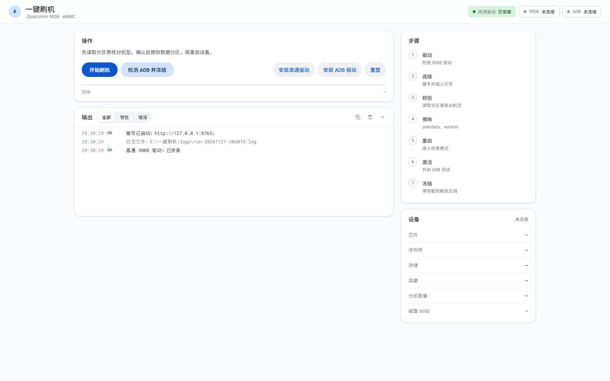
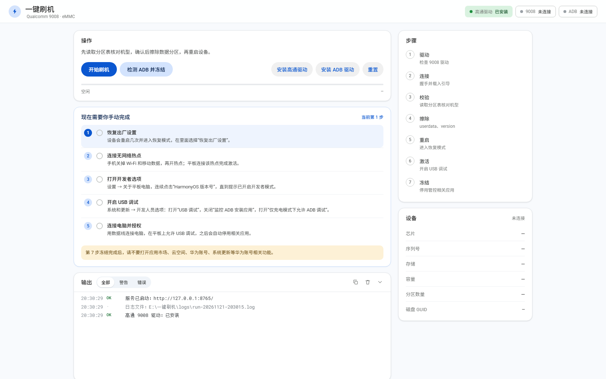

# 一键刷机 · 高通 9008

面向华为/荣耀高通平板（eMMC）的 9008 深度刷机工具：本地 Python 后端 + 浏览器界面。
走 QDLoader 的 COM 串口跑 Sahara / Firehose，不需要 libusb、Zadig 或额外授权工具。

界面为 Material 3 浅色风格（Roboto 字体随包内置，离线可用）。



## 功能

- 启动时自动检查高通 9008 驱动（`pnputil` 中的 `qcser.inf`），缺失则提权静默安装
- 读取设备标识（序列号、MSM HW ID）与 GPT 分区表，校验机型后才会继续
- 擦除 `userdata` / `version`（两次确认），再重启设备
- 重启后按 5 步手动清单引导：恢复出厂 → 无网络热点激活 → 开发者选项 → USB 调试 → 授权连接
- ADB 连接后自动停用 `com.huawei.hwid`、`com.huawei.android.hwouc`、
  `com.huawei.hms.dupdateengine`、`com.huawei.android.hsf`，并提示不要使用华为账号相关功能
- 全程日志写入 `logs/`，界面底部控制台支持等级过滤、复制、折叠

## 目录结构

```
app/server.py            后端：HTTP API + 状态机 + EDL/ADB 编排
app/qedl_core.py         Sahara / Firehose / GPT 解析
web/                     前端（index.html / app.css / app.js / fonts）
cli/read_info.py         命令行：识别设备并打印分区表
cli/read_gpt_fast.py     命令行：最短路径读 GPT
cli/watch_and_read.py    命令行：等拔插后自动回读并保存
assets/loaders/          9008 引导（HuaweiCommon_680_devprg.elf）
assets/drivers/          高通 USB 驱动、ADB 驱动安装包
assets/icon/             应用图标
tools/platform-tools/    adb 37.0.3
scripts/build_exe.py     打包脚本
scripts/make_icon.py     生成图标
docs/                    截图与样例数据
logs/                    运行日志（不入库）
```

## 使用

### 直接运行打包版

双击 `一键刷机.exe`（首次启动自解压约 10~15 秒），程序会启动本地服务并打开
`http://127.0.0.1:8765/`。重复双击只会再打开一个页面。

### 源码运行

```bat
pip install -r requirements.txt
启动.cmd
```

或 `python app/server.py`。

### 命令行

```bat
python cli/read_info.py        :: 识别设备 + 打印分区表
python cli/read_gpt_fast.py    :: 最短路径读 GPT，写 gpt.json
python cli/watch_and_read.py   :: 等拔插后自动回读
```

## 打包

```bat
pip install -r requirements-dev.txt
python scripts/build_exe.py
```

产物在 `dist/一键刷机.exe`。

## 流程

1. **驱动**：缺驱动先装（UAC）。
2. **连接**：等 9008 端口 → Sahara 握手（必要时 `0x13` 复位状态机）→ 上传引导 → `configure(emmc)`。
3. **校验**：读 GPT，核对 eMMC、MSM_ID（预期 `0x1B80E1` / SM6225）、关键分区，不符即中止。
4. **擦除**：弹窗询问是否擦除 `userdata` + `version` → 二次确认 → `<erase>`（不支持则退回写零）。
5. **重启**：`<power value="reset"/>`，并弹出 5 步手动清单。
6. **激活**：按清单操作，直到设备以 `device` 状态出现在 `adb devices`。
7. **停用**：执行 `pm disable-user --user 0 <包名>`，完成后提示不要使用华为账号 / HMS 功能。

恢复被停用的应用：`adb shell pm enable <包名>`。



## 协议要点（踩过的坑）

1. PBL 的 Sahara HELLO **只广播一次**，驱动重绑后端口静默，主机需补发 `HELLO_RSP`。
2. 命令模式与镜像传输互斥：读完序列号/MSM ID 后发 `0x13` 复位状态机再走镜像握手。
3. 64 位数据请求是 `0x12`，字段 `image_id(8) offset(8) len(8)`；按 4 字节解析会 MemoryError。
4. 残留 `READ_DATA` 要丢弃，否则长度不符，目标回 `END_TRANSFER status=0x8`。
5. `RESET_REQ (0x07)` 会让 PBL 停止服务 OUT 端点，只能拔插 USB；恢复用 `0x13`。
6. 关闭会话后设备会掉出 USB，下次使用需拔插一次数据线。

## 已验证设备

| 项 | 值 |
|---|---|
| 芯片 | SM6225 / 骁龙 680（MSM_ID `0xB80E1`） |
| 存储 | eMMC 58.24 GB / 122,142,720 扇区 |
| 分区 | GPT 69 个（`oeminfo`、`super`、`userdata`、`version`、`boot` 等） |

读取结果样例见 `docs/samples/`（序列号、HW ID、磁盘 GUID 均已脱敏）。

## 说明

- 擦除、重启、ADB 停用三段目前只有代码路径，未在真机上完整跑通，请自行评估风险。
- 仅在自有设备上用于恢复出厂/重新激活场景，请遵守当地法律与设备保修条款。

## 许可

GPL-3.0，见 [LICENSE](LICENSE)。
